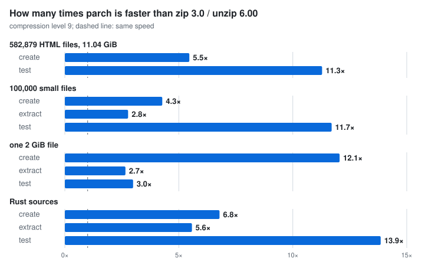
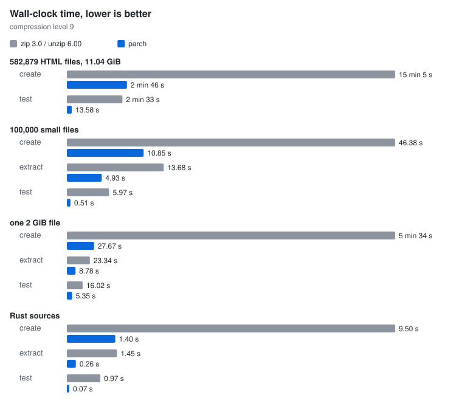
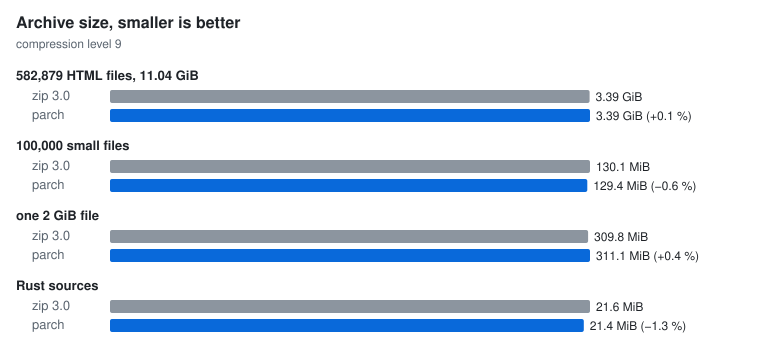

# parch

A parallel ZIP archiver written in Rust.

parch writes standard ZIP archives that `unzip`, `bsdtar`, Python's `zipfile` and macOS `ditto` read, and it reads the archives these tools create. By default it uses ¾ of the available CPU cores. It is designed for directories with many files.

On a real directory of 582,879 files (11 GiB), parch created the archive 5.5× faster than `zip -9r` at the same compression level.

## Benchmarks

`zip -9r` is compared with `parch c -9`, so both tools compress at level 9. parch uses all 8 cores (`-j 100%`). Each command ran once, and the times are wall-clock times.

### Test machine

| | |
|---|---|
| CPU | 8 cores: 2 × Cortex-A76 at 2.0 GHz and 6 × Cortex-A55 at 1.8 GHz |
| RAM | 3.7 GiB |
| Storage | NVMe SSD, ext4 |
| OS | Armbian 26.11 (Debian 13), Linux 6.6 |
| Tools | zip 3.0, unzip 6.00 (Debian packages), parch 0.1.0 |

The board also runs other services, which keep its load average at about 0.5. The benchmarks ran under `nice -n 10` in a cgroup with a 2 GiB memory limit. With all 8 cores busy, the CPU temperature stayed at or below 60 °C, under the 70 °C point where throttling starts.

### Results



| Data set | Operation | zip 3.0 / unzip 6.00 | parch | Speed-up |
|---|---|---:|---:|---:|
| 582,879 HTML files, 11.04 GiB | create | 15 min 5 s | **2 min 46 s** | 5.5× |
| | test | 2 min 33 s | **13.58 s** | 11.3× |
| 100,000 small files, 579 MiB | create | 46.38 s | **10.85 s** | 4.3× |
| | extract | 13.68 s | **4.93 s** | 2.8× |
| | test | 5.97 s | **0.51 s** | 11.7× |
| one 2 GiB file | create | 5 min 34 s | **27.67 s** | 12.1× |
| | extract | 23.34 s | **8.78 s** | 2.7× |
| | test | 16.02 s | **5.35 s** | 3.0× |
| Rust sources, 7,237 files, 100 MiB | create | 9.50 s | **1.40 s** | 6.8× |
| | extract | 1.45 s | **0.26 s** | 5.6× |
| | test | 0.97 s | **0.07 s** | 13.9× |

The zip 3.0 / unzip 6.00 column uses `zip -9r` to create, `unzip` to extract and `unzip -t` to test. The parch column uses `parch c -9`, `parch x` and `parch t`. Extraction and testing read the archive made by parch. Times are rounded to 0.01 s, so the speed-ups of the shortest runs are approximate.



While archiving the 11 GiB data set, `zip` used 0.9 CPU cores and at most 421 MiB of memory, and parch used 6.6 cores and at most 152 MiB. `unzip -t` found no errors in parch's archive, which has 584,236 entries and therefore uses ZIP64.

| Data set | `zip -9r` | `parch c -9` | Difference |
|---|---:|---:|---:|
| 582,879 HTML files | 3,640,650,630 bytes | 3,643,617,327 bytes | +0.1 % |
| 100,000 small files | 136,454,516 bytes | 135,676,097 bytes | −0.6 % |
| one 2 GiB file | 324,901,013 bytes | 326,163,576 bytes | +0.4 % |
| Rust sources | 22,686,137 bytes | 22,391,019 bytes | −1.3 % |

parch compresses with libdeflate and zlib-rs, so its archives differ slightly in size from those of zip 3.0.



### Data sets and how to reproduce

- **582,879 HTML files**: a real directory with 1,357 subdirectories, 11.04 GiB. It does not fit in RAM, so it is read from the SSD.
- **100,000 small files**: text-like files with log-normal sizes (median about 3 KB) in 1,000 directories, made by `scripts/gen_tree.py`.
- **one 2 GiB file**: a 1 MiB text block repeated 2,048 times, with 4 KiB of random bytes after each copy.
- **Rust sources**: the project's dependencies, vendored with `cargo vendor`.

`scripts/bench.sh` generates the three synthetic data sets in `target/bench` and reads each one before its runs to warm the page cache. The 2 GiB file is larger than the 2 GiB memory limit, so part of it was read from the SSD. `scripts/bench_charts.py` draws SVG charts from the output of `bench.sh`.

```bash
LEVEL=9 PARCH_THREADS=100% scripts/bench.sh | tee bench.log
scripts/bench_charts.py --zip 'zip 3.0' --unzip 'unzip 6.00' bench.log   # charts in target/bench/charts
```

On your own directory:

```bash
rm -f z.zip p.zip
time zip -9r -q z.zip DIR
time parch c -9 -q -j 100% p.zip DIR
```

## Features

- Standard ZIP (PKWARE APPNOTE 6.3). ZIP64 is used automatically for 65,535 or more entries and for files or archives of 4 GiB or more.
- Writes Store and Deflate with levels 0–12 (6 by default; 10–12 are slower and compress harder). Reads Store, Deflate, Deflate64, BZip2, LZMA, XZ, Zstandard and PPMd.
- Scanning, compression, extraction and testing all run in parallel.
- Small files are packed into batches. Large files are split into 1 MiB chunks that are compressed in parallel and joined into one standard deflate stream, as pigz does.
- Files that are already compressed (`jpg`, `mp4`, `zip` and others), and data that does not shrink, are stored without compression.
- `add` (with `-u` update and `-f` freshen modes) and `delete` copy the remaining entries without recompressing them.
- Can write the archive to stdout, read it from stdin, and extract files to stdout.
- Keeps Unix permissions, modification times, uid/gid and symlinks. On Windows it keeps NTFS timestamps and DOS attributes.
- Handles UTF-8 names, and legacy code pages such as CP437, CP866 and windows-1251 for both reading and writing.
- Safe extraction: blocks `..` path escapes and symlinks that lead outside the target directory, strips absolute paths, and always checks CRC-32 and sizes.
- `--sort` writes entries in name order, and `--reproducible` also normalizes permissions and times (honors `SOURCE_DATE_EPOCH`).
- Writes the archive to a temporary file and renames it only on success. Ctrl-C removes the temporary file.
- Shows a progress bar with percentage and ETA.

## Installation

You need Rust and a C compiler (libdeflate and zstd are built from source). The crates declare Rust 1.88 as the minimum version; builds are tested with Rust 1.93.

```bash
cargo install --locked --path crates/parch-cli   # installs parch into ~/.cargo/bin
# or
cargo build --release                            # binary: target/release/parch
```

`scripts/release/build.sh` builds `.deb` and `.tar.gz` packages on Debian or Ubuntu.

## Usage

```bash
parch c archive.zip dir        # create
parch x archive.zip -C dest    # extract into dest
parch l archive.zip            # list (-v for methods, sizes and CRCs)
parch t archive.zip            # test
parch a -u archive.zip dir     # add new files and replace entries whose files are newer
parch d archive.zip '*.log'    # delete entries
```

More examples:

```bash
parch c -9 -x '*.log' -x node_modules backup.zip project   # level 9, with exclusions
parch c -j 50% data.zip data                                # use half of the cores
parch c -C project out.zip .                                # names relative to project/
parch c - dir | ssh host 'cat > dir.zip'                    # archive to stdout
find . -name '*.rs' -print0 | parch c --null -T - src.zip   # file list from stdin
parch x -p archive.zip docs/readme.txt                      # one file to stdout
parch x -O cp866 old.zip -C out                             # names from old DOS/Windows archives
SOURCE_DATE_EPOCH=1700000000 parch c --reproducible release.zip dist
```

| Option | Description |
|---|---|
| `-j, --threads <N\|P%>` | Worker threads: a number or a share of the cores (default `75%`, env `PARCH_THREADS`) |
| `-0` … `-9`, `-l <0-12>` | Compression level (default 6) |
| `-m, --method <store\|deflate>` | Compression method |
| `-x`, `-i <GLOB>` | Exclude or include names |
| `-o`, `-u` | Extraction: overwrite existing files, or overwrite only older ones |
| `--memory <SIZE>` | Limit on data in flight (default `256M`) |
| `-q`, `-v` | Quiet, or print each entry |

Run `parch help <command>` to see all options.

Exit codes: `0` success, `1` warnings (skipped files, conflicts), `2` errors (damaged archive, CRC mismatch, I/O error), `130` interrupted.

## Compatibility

Archives were checked in both directions with zip 3.0 and unzip 6.00 (including `zipinfo`), `bsdtar` (libarchive 3.7.4), Python `zipfile`, macOS `ditto` and the Rust `zip` crate 9. Archives with a file over 4 GiB, archives over 4 GiB, and archives with 70,000 entries pass `unzip -t`. `scripts/compat.sh` repeats these checks with the tools installed on your system.

## How it works

- A single pool of worker threads scans directories and compresses files. Compression takes priority, and scanning pauses if it gets far ahead.
- Files under 256 KiB are grouped into batches of up to 128 files or 4 MiB. Each file is read with one call, using its size from `stat`.
- Files up to 8 MiB are compressed whole with libdeflate. Larger files are split into 1 MiB chunks. Each chunk is compressed with zlib-rs, using the previous 32 KiB as a dictionary, and ends with a sync flush, so the chunks join into one valid deflate stream.
- One writer thread writes entries as they finish. Local headers contain the final CRC and sizes, so data descriptors are needed only for large files written to a pipe.
- A memory budget (`--memory`) limits how much data is in flight.
- Extraction reads the archive with positional reads from one file descriptor and decodes entries in parallel. Directories are created first, and name collisions are resolved before any file is written.

The code is split into crates: `parch-core` (format-independent pipeline), `parch-codecs` (compression methods), `parch-zip` (the ZIP format) and `parch-cli` (the `parch` binary). A new archive format implements the `ArchiveFormat` trait and is registered in `crates/parch-cli/src/registry.rs`.

## Limitations

- No encryption. Encrypted entries (ZipCrypto, AES) are shown in the listing, and extracting them reports an error.
- No split or spanned (multi-volume) archives.
- Writes only Store and Deflate. Shrink, Reduce and Implode are not supported.
- Reading Deflate64 is implemented but not yet tested on real archives.
- Windows support is implemented but has not been built or tested yet. Linux and macOS are tested.

## License

Licensed under either the [MIT license](LICENSE-MIT) or the [Apache License 2.0](LICENSE-APACHE), at your option.
